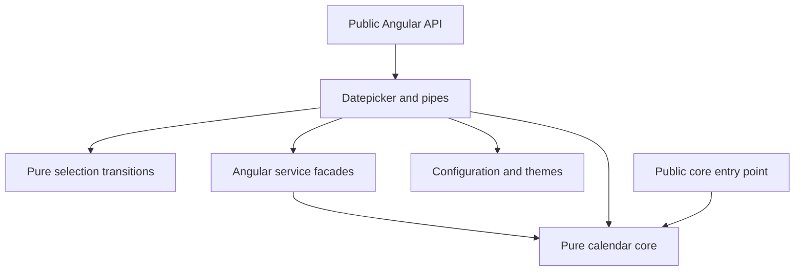

# Architecture

This documents the implemented checkpoint, not the completed toolkit.

The workspace separates the publishable package at `libs/ngx-nepali-dualpicker` from the playground at `apps/playground` and documentation at `apps/documentation`. Each target owns its source and TypeScript project configuration; Angular workspace configuration and development tools remain at the root. Both applications consume the built package, with only build-time package metadata read from the library manifest.

Shared example data, the code viewer and cross-application links live under `apps/shared`. The documentation owns the guides and generated API signatures; the playground owns the interactive configuration preview. Each app has independent build, serve and test targets.

The playground page owns preview configuration, form state, event inspection and generated integration code. Configuration edits are passed directly to a stable picker instance so updates exercise the library's runtime reconciliation. Loading a preset starts a new adapter because its initial value belongs to the new calendar and must not be interpreted in the previous calendar. Its independent booking demo owns its own form, availability rules, month presets and custom cell template under `pages/playground/booking-demo`. Shared example descriptions must stay consistent with the public API; copied snippets are compiled by `check:docs`.

The playground's JSON editor validates input in `parse-playground-config.ts` before applying it. Invalid drafts leave the last working preview intact. Form values and status come from reactive form streams, while controls, calendar/mode toggles and generated code share the current configuration. Appearance changes preserve values; calendar, mode and output-format edits clear incompatible values. JSON supports static presets and date restrictions; callbacks and projected templates remain TypeScript examples in the booking demo.

## Dependency direction

`core/` contains no Angular, CDK, RxJS, configuration or DOM imports. Its functions use one-based month fields. Conversion retains the original epoch, cumulative offsets and binary search. The injectable service delegates to the core rather than implementing a second engine.

`datepicker/state/selection-transitions.ts` owns immutable multiple and range transitions. The Angular adapter supplies ordering and restrictions. Multiple values retain first-occurrence order. Range normalization rejects orphan endpoints and orders complete ranges. Clicks and external writes share these rules. Manual input has a separate parsing adapter and reports excess multiple selections as errors.

`configuration/` owns defaults, DI token and merge behavior. DatePickerConfigService owns a signal and replaces state on updates. Reads clone nested objects, arrays and Dates. Nested objects merge, arrays replace, undefined is ignored, and null clears min/max restrictions. Instance configuration overrides application defaults. The token is initialization data, not a mutable runtime store.

`themes/` contains definitions and DOM adapters outside the core. The public ThemeService API retains explicit global operations; PickerThemeController owns per-instance effects without changing document-root styles.

Internal modules use direct imports; broad internal barrels were removed. `check:architecture` checks static import boundaries, missing modules and cycles. ESLint checks consumer import conventions. These checks do not replace runtime or accessibility tests.

## Public entry points

`ngx-nepali-dualpicker` retains Angular components, services, provider, configuration and date pipe. `ngx-nepali-dualpicker/core` exports conversion, arithmetic, validation, parsing, picker-format helpers and date types without Angular runtime imports.

No CDK or Tailwind dependency was added. CDK adoption requires verified major-version peers. Components include their own SCSS.

## Remaining architecture work

The main picker remains the Angular forms and state orchestration adapter. Grid and month/year rendering, keyboard commands, popup geometry/listeners and cell presentation live in focused modules. Further decomposition should follow independent responsibilities rather than a file-length target. Its legacy exposed state uses zero-based months through PickerDate; those members are not a new date-domain API. Runtime configuration reconciliation, theme isolation and keyboard focus have regression coverage. A unified formatting/parser grammar and full SSR/accessibility verification remain follow-up work.

## Source organization

See [Source layout and naming](SOURCE-LAYOUT.md) for current paths. Configuration models and defaults, theme contracts and presets, and popup geometry and browser listeners are separate modules. Calendar-cell presentation is built outside the main component. Shared application code is grouped into components, configuration and content.

The current [architecture review](architecture/refactor-report.md) records the complete audit and executed consumer matrix. PickerPopupController now owns each popup's coordinates, measurements and active listener cleanup; open/closed and form state remain with the component. CalendarSystem lives in domain models, and numeral conversion is shared within calendar locale code.
