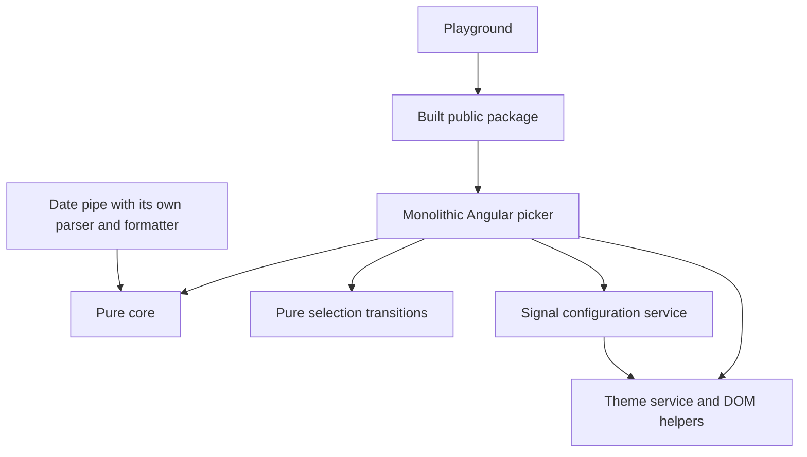

# Current architecture before this refactor

Snapshot: 2026-10-30, taken from the opened workspace before this turn's source changes. Existing uncommitted work is retained. Angular 17.3 / TypeScript 5.4; library under libs, playground under apps. This is not the original external repository audit.

## Baseline

Executed: npm run check, npm run build, npm test and npm run test:playground. All passed; 60 library and 36 playground tests ran in Edge 156 through Karma. Local Node is 24.19.0; the workspace pins 20.19.0. No cross-major compatibility claim follows from this run.

## Actual library tree

```text
libs/ngx-nepali-dualpicker/core/ng-package.json
libs/ngx-nepali-dualpicker/ng-package.json
libs/ngx-nepali-dualpicker/package.json
libs/ngx-nepali-dualpicker/src/core-api.ts
libs/ngx-nepali-dualpicker/src/lib/configuration/datepicker-config.ts
libs/ngx-nepali-dualpicker/src/lib/configuration/datepicker-token.ts
libs/ngx-nepali-dualpicker/src/lib/configuration/merge-config.ts
libs/ngx-nepali-dualpicker/src/lib/core/calendar/calendar-data.ts
libs/ngx-nepali-dualpicker/src/lib/core/calendar/conversion.ts
libs/ngx-nepali-dualpicker/src/lib/core/calendar/date-calculator.ts
libs/ngx-nepali-dualpicker/src/lib/core/calendar/date-utils.spec.ts
libs/ngx-nepali-dualpicker/src/lib/core/formatting/date-formatter.ts
libs/ngx-nepali-dualpicker/src/lib/core/locale/calendar-labels.ts
libs/ngx-nepali-dualpicker/src/lib/core/locale/numerals.ts
libs/ngx-nepali-dualpicker/src/lib/core/models/date.ts
libs/ngx-nepali-dualpicker/src/lib/core/parsing/date-parser.ts
libs/ngx-nepali-dualpicker/src/lib/core/validation/date-validator.ts
libs/ngx-nepali-dualpicker/src/lib/datepicker/ngx-nepali-dualpicker.html
libs/ngx-nepali-dualpicker/src/lib/datepicker/ngx-nepali-dualpicker.scss
libs/ngx-nepali-dualpicker/src/lib/datepicker/ngx-nepali-dualpicker.spec.ts
libs/ngx-nepali-dualpicker/src/lib/datepicker/ngx-nepali-dualpicker.ts
libs/ngx-nepali-dualpicker/src/lib/datepicker/state/selection.spec.ts
libs/ngx-nepali-dualpicker/src/lib/datepicker/state/selection.ts
libs/ngx-nepali-dualpicker/src/lib/pipes/nepali-date.pipe.spec.ts
libs/ngx-nepali-dualpicker/src/lib/pipes/nepali-date.pipe.ts
libs/ngx-nepali-dualpicker/src/lib/pipes/nepali-numeral.pipe.ts
libs/ngx-nepali-dualpicker/src/lib/provide-nepali-dualpicker.ts
libs/ngx-nepali-dualpicker/src/lib/services/date-conversion.service.spec.ts
libs/ngx-nepali-dualpicker/src/lib/services/date-conversion.service.ts
libs/ngx-nepali-dualpicker/src/lib/services/date-picker-config.service.spec.ts
libs/ngx-nepali-dualpicker/src/lib/services/date-picker-config.service.ts
libs/ngx-nepali-dualpicker/src/lib/services/theme.service.ts
libs/ngx-nepali-dualpicker/src/lib/themes/internal/theme-applier.util.ts
libs/ngx-nepali-dualpicker/src/lib/themes/internal/theme-detector.util.ts
libs/ngx-nepali-dualpicker/src/lib/themes/internal/theme-merger.util.ts
libs/ngx-nepali-dualpicker/src/lib/themes/theme.ts
libs/ngx-nepali-dualpicker/src/public-api.ts
libs/ngx-nepali-dualpicker/tsconfig.lib.json
libs/ngx-nepali-dualpicker/tsconfig.lib.prod.json
libs/ngx-nepali-dualpicker/tsconfig.spec.json
```

## Dependencies and flows



Conversion uses DateParser -> DateValidator -> DateCalculator, the retained BS table and epoch. Cumulative month starts and binary search are efficient and must remain. The public root exports the component, provider, three services, config token/defaults, presets, date pipe and Calendar enum; named types include DateObj, DateInput, DatePickerValue, DatePickerConfig, CalendarSystem and themes. The core entry point exposes conversion, DateCalculator, DateValidator, DateParser and formatPickerDate. No currency implementation remains at this baseline.

## State ownership

The picker owns selection signals, mode flags, focused date, formatted text, edit text, visibility, disabled state, displayed date object, mutable year array and mutable month-grid columns. These duplicate derived data; explicit refresh calls synchronize them. The config service owns a signal but picker modes/year/grid only initialize once. The theme service owns an RxJS subject while the picker independently resolves its configured theme. Config construction also applies document-root variables.

## Verified weaknesses

High: monolithic picker; runtime config leaves mode/grid/year state stale; selectMonth, toggleMode and selectToday do not all guard disabled controls; external writes and manual/programmatic paths have separate normalization.

Medium: host keyboard handler treats inline visibility as closed; DOM focus is not synchronized; all dates are tab stops; month/year div buttons rely on mouse events; configuration applies global theme side effects; :root tokens and class-only selectors escape the library host; pipe contains a second parser/formatter.

Low: component filename lacks the component suffix; UI types live with core date models; numerous imperative detectChanges calls; unneeded number-word tables survive the earlier currency removal. SSR guards exist, but current-day/server-time determinism and hydration are unverified. Conversion data provenance is not independently certified.

## Strengths to preserve

Standalone OnPush components, strict TS/template checks, existing CVA shapes and one-based public service dates; isolated core entry point; tested selection helpers; efficient conversion; included SCSS without Tailwind; no CDK/Material consumer requirement; packed-consumer and CI scripts; public-package playground imports.

## File-level assessment

| Current file                                                                     | Responsibility                                                            | Verified issue / debt                                                     | Recommended action                                 |
| -------------------------------------------------------------------------------- | ------------------------------------------------------------------------- | ------------------------------------------------------------------------- | -------------------------------------------------- |
| `libs/ngx-nepali-dualpicker/core/ng-package.json`                                | Focused calendar, locale or packaging module                              | No additional confirmed structural defect                                 | Keep                                               |
| `libs/ngx-nepali-dualpicker/ng-package.json`                                     | Focused calendar, locale or packaging module                              | No additional confirmed structural defect                                 | Keep                                               |
| `libs/ngx-nepali-dualpicker/package.json`                                        | Focused calendar, locale or packaging module                              | No additional confirmed structural defect                                 | Keep                                               |
| `libs/ngx-nepali-dualpicker/src/core-api.ts`                                     | Supported package exports                                                 | No additional confirmed structural defect                                 | Keep                                               |
| `libs/ngx-nepali-dualpicker/src/lib/configuration/datepicker-config.ts`          | Typed configuration and immutable merging                                 | No additional confirmed structural defect                                 | Keep                                               |
| `libs/ngx-nepali-dualpicker/src/lib/configuration/datepicker-token.ts`           | Defaults injection token                                                  | Shallow default clone leaks nested references                             | Use merge factory                                  |
| `libs/ngx-nepali-dualpicker/src/lib/configuration/merge-config.ts`               | Typed configuration and immutable merging                                 | No additional confirmed structural defect                                 | Keep                                               |
| `libs/ngx-nepali-dualpicker/src/lib/core/calendar/calendar-data.ts`              | BS month lengths and epoch                                                | Provenance and nominal/conversion range distinction not certified         | Keep data; document limits                         |
| `libs/ngx-nepali-dualpicker/src/lib/core/calendar/conversion.ts`                 | BS/AD conversion facade or engine                                         | No additional confirmed structural defect                                 | Keep                                               |
| `libs/ngx-nepali-dualpicker/src/lib/core/calendar/date-calculator.ts`            | Month table offsets, binary search and arithmetic                         | No independent data provenance verification                               | Keep algorithm                                     |
| `libs/ngx-nepali-dualpicker/src/lib/core/calendar/date-utils.spec.ts`            | Regression tests                                                          | No additional confirmed structural defect                                 | Keep                                               |
| `libs/ngx-nepali-dualpicker/src/lib/core/formatting/date-formatter.ts`           | Focused calendar, locale or packaging module                              | No additional confirmed structural defect                                 | Keep                                               |
| `libs/ngx-nepali-dualpicker/src/lib/core/locale/calendar-labels.ts`              | Focused calendar, locale or packaging module                              | No additional confirmed structural defect                                 | Keep                                               |
| `libs/ngx-nepali-dualpicker/src/lib/core/locale/numerals.ts`                     | Focused calendar, locale or packaging module                              | No additional confirmed structural defect                                 | Keep                                               |
| `libs/ngx-nepali-dualpicker/src/lib/core/models/date.ts`                         | Calendar fields, UI mapping and form values                               | One type represents both month conventions                                | Separate public date and internal picker contracts |
| `libs/ngx-nepali-dualpicker/src/lib/core/parsing/date-parser.ts`                 | Public date input parsing                                                 | Numeric patterns accept arbitrary separators/exponent syntax              | Retain API; enforce exact patterns                 |
| `libs/ngx-nepali-dualpicker/src/lib/core/validation/date-validator.ts`           | Focused calendar, locale or packaging module                              | No additional confirmed structural defect                                 | Keep                                               |
| `libs/ngx-nepali-dualpicker/src/lib/datepicker/ngx-nepali-dualpicker.html`       | All picker rendering                                                      | Unmanaged tab order and semantic div buttons; parent coupling             | Split grid and month/year panels                   |
| `libs/ngx-nepali-dualpicker/src/lib/datepicker/ngx-nepali-dualpicker.scss`       | Tokens, all picker styling and responsive rules                           | Global :root defaults and generic class selectors                         | Scope tokens/styles to component host              |
| `libs/ngx-nepali-dualpicker/src/lib/datepicker/ngx-nepali-dualpicker.spec.ts`    | Regression tests                                                          | No additional confirmed structural defect                                 | Keep                                               |
| `libs/ngx-nepali-dualpicker/src/lib/datepicker/ngx-nepali-dualpicker.ts`         | CVA, state, restrictions, parsing, navigation, themes, keyboard and popup | God component; mutable grid/display caches; repeated detectChanges        | Split                                              |
| `libs/ngx-nepali-dualpicker/src/lib/datepicker/state/selection.spec.ts`          | Regression tests                                                          | No additional confirmed structural defect                                 | Keep                                               |
| `libs/ngx-nepali-dualpicker/src/lib/datepicker/state/selection.ts`               | Pure range/multiple transitions                                           | Not consistently reused by manual/programmatic paths                      | Retain and centralize normalization                |
| `libs/ngx-nepali-dualpicker/src/lib/pipes/nepali-date.pipe.spec.ts`              | Regression tests                                                          | No additional confirmed structural defect                                 | Keep                                               |
| `libs/ngx-nepali-dualpicker/src/lib/pipes/nepali-date.pipe.ts`                   | Parsing, formatting, numerals, weekday calculation                        | Angular pipe owns pure algorithms                                         | Extract pure formatter; keep pipe thin             |
| `libs/ngx-nepali-dualpicker/src/lib/pipes/nepali-numeral.pipe.ts`                | Focused calendar, locale or packaging module                              | No additional confirmed structural defect                                 | Keep                                               |
| `libs/ngx-nepali-dualpicker/src/lib/provide-nepali-dualpicker.ts`                | Focused calendar, locale or packaging module                              | No additional confirmed structural defect                                 | Keep                                               |
| `libs/ngx-nepali-dualpicker/src/lib/services/date-conversion.service.spec.ts`    | Regression tests                                                          | No additional confirmed structural defect                                 | Keep                                               |
| `libs/ngx-nepali-dualpicker/src/lib/services/date-conversion.service.ts`         | BS/AD conversion facade or engine                                         | No additional confirmed structural defect                                 | Keep                                               |
| `libs/ngx-nepali-dualpicker/src/lib/services/date-picker-config.service.spec.ts` | Regression tests                                                          | No additional confirmed structural defect                                 | Keep                                               |
| `libs/ngx-nepali-dualpicker/src/lib/services/date-picker-config.service.ts`      | Reactive global defaults plus global DOM theme mutation                   | Configuration reading applies global styles                               | Remove theme side effects                          |
| `libs/ngx-nepali-dualpicker/src/lib/services/theme.service.ts`                   | Public theme facade and DOM adapter                                       | Mutable preset references; system observer can replace explicit selection | Retain facade; isolate component theme ownership   |
| `libs/ngx-nepali-dualpicker/src/lib/themes/internal/theme-applier.util.ts`       | Theme definitions or focused theme adapter                                | No additional confirmed structural defect                                 | Keep                                               |
| `libs/ngx-nepali-dualpicker/src/lib/themes/internal/theme-detector.util.ts`      | Theme definitions or focused theme adapter                                | No additional confirmed structural defect                                 | Keep                                               |
| `libs/ngx-nepali-dualpicker/src/lib/themes/internal/theme-merger.util.ts`        | Theme definitions or focused theme adapter                                | No additional confirmed structural defect                                 | Keep                                               |
| `libs/ngx-nepali-dualpicker/src/lib/themes/theme.ts`                             | Theme definitions or focused theme adapter                                | No additional confirmed structural defect                                 | Keep                                               |
| `libs/ngx-nepali-dualpicker/src/public-api.ts`                                   | Supported package exports                                                 | No additional confirmed structural defect                                 | Keep                                               |
| `libs/ngx-nepali-dualpicker/tsconfig.lib.json`                                   | Typed configuration and immutable merging                                 | No additional confirmed structural defect                                 | Keep                                               |
| `libs/ngx-nepali-dualpicker/tsconfig.lib.prod.json`                              | Typed configuration and immutable merging                                 | No additional confirmed structural defect                                 | Keep                                               |
| `libs/ngx-nepali-dualpicker/tsconfig.spec.json`                                  | Typed configuration and immutable merging                                 | No additional confirmed structural defect                                 | Keep                                               |
