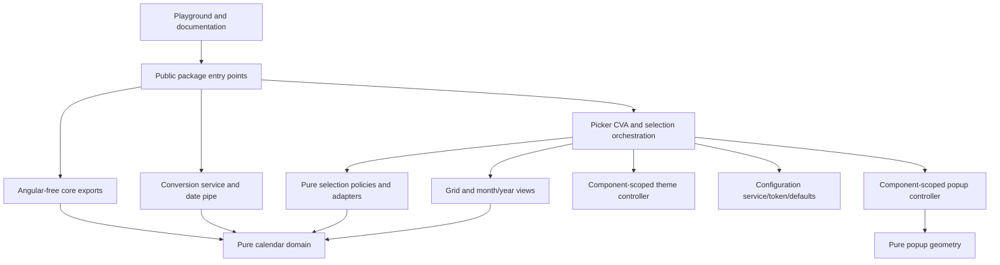

# AD/BS datepicker architecture review and incremental refactor

Review date: 2026-10-30. This is the architecture-refactor snapshot before the later accessibility/forms feature expansion; current feature behavior is documented in [Accessible forms](../ACCESSIBILITY-AND-FORMS.md). Scope: the current workspace, including existing uncommitted work. No publish, remote push, package-name change, selector rename, new datepicker capability, CDK dependency or replacement calendar dataset was performed.

## A. Executive architecture assessment

The repository already has a useful feature-oriented architecture. The publishable Angular 17.3 library is separate from the playground and documentation. Root and `/core` entry points separate Angular integration from calendar operations. Pure selection policies, configuration cloning, component-scoped theme ownership, focused grid/month-year views and dependency checks are already present. Adopting a different `projects/` hierarchy or a global state framework would add migration cost without solving a demonstrated problem.

The remaining substantial risks are calendar-data provenance, the breadth of legacy component declarations, format/parser differences, incomplete accessibility semantics, and hydration/production-server coverage. The main component is still sizeable because it preserves the existing forms, state and imperative API. This refactor removes an independent browser responsibility rather than splitting arbitrary blocks to meet a line-count target.

Two defects were reproduced with failing tests before their fixes: system-theme changes left target CSS on the previous theme, and invalid Gregorian month lookups returned undefined despite their numeric return type. No valid conversion result, reference date, table row or supported range was changed.

## B. Current directory tree

The complete pre-implementation source/configuration tree is recorded in [review-baseline.md](review-baseline.md), followed by a file-by-file assessment covering responsibilities, declarations, static imports, findings, recommended actions and risks. Dependency installations, generated builds, Git internals and temporary fixtures are excluded. Existing audit snapshots remain historical records rather than being silently rewritten as current facts.

## C. Architectural problems

| Priority | Finding and consequence                                                                                                                                                             | Disposition                                                                                                                                     |
| -------- | ----------------------------------------------------------------------------------------------------------------------------------------------------------------------------------- | ----------------------------------------------------------------------------------------------------------------------------------------------- |
| Critical | No critical runtime corruption was established by the available evidence.                                                                                                           | Do not invent a conversion correction.                                                                                                          |
| High     | No authoritative provenance or independent full-range validation for the BS month table. Round trips can agree around the same inaccurate table.                                    | Release limitation remains explicit; data unchanged.                                                                                            |
| High     | Declared Angular peers previously exceeded executed compatibility evidence; consumer harness rejected an unsupported test `--port` option.                                          | Fix harness and run packed consumers with supported toolchains. Exact versions and scope are in J/M.                                            |
| Medium   | Popup measurement, listener ownership and coordinate state were mixed into the CVA component.                                                                                       | Extract a private, component-scoped popup controller.                                                                                           |
| Medium   | System-theme Observable updated while target CSS remained light.                                                                                                                    | Failing regression reproduced; CSS target now updates and listener cleanup is checked.                                                          |
| Medium   | `getDaysInAdMonth(2024, 0)` returned undefined as a number.                                                                                                                         | Failing regression reproduced; reject invalid year/month fields. Valid inputs unchanged.                                                        |
| Medium   | Formatting accepts named-month display but editable parsing accepts numeric patterns; range/multiple delimiters impose additional constraints.                                      | Preserve grammar and document supported combinations; no new parser feature.                                                                    |
| Medium   | Public component declarations include mutable legacy UI state and rendering helpers. Zero-based `PickerDate` and one-based public dates are structurally compatible.                | Retain compatibility; document preferred config/forms/events boundary and explicit adapters. A future breaking cleanup needs its own migration. |
| Medium   | Popup advertises a dialog via `aria-haspopup`, but the container lacks a complete dialog/controls relationship. Labels are abbreviated; no screen-reader or automated axe evidence. | Document remaining accessibility work; preserve current keyboard behavior and tested focus restoration. Do not claim WCAG conformance.          |
| Medium   | Server rendering smoke does not prove production AOT SSR or hydration. Clock, timezone and system-theme differences can alter server/client output.                                 | Real renderer smoke added; production SSR/hydration remain unverified.                                                                          |
| Low      | Numeral conversions were repeated in the parser, formatter, numeral pipe and cell presentation builder.                                                                             | Delegate to one pure locale implementation.                                                                                                     |
| Low      | `CalendarSystem` was defined in the operations module.                                                                                                                              | Move its contract to domain models; retain public export.                                                                                       |
| Low      | README theme dimensions example omitted required nested fields; some docs described already-fixed behavior as broken.                                                               | Correct example and current guidance.                                                                                                           |
| Low      | Angular 20+ warns about `allowSignalWrites`.                                                                                                                                        | Retain it for Angular 17 compatibility; do not introduce version detection merely to suppress a development warning.                            |

## D. Proposed architecture

Retain the existing calendar domain, picker feature, Angular adapters, configuration and theme owners. Introduce only modules with demonstrated independent responsibilities: a calendar-system contract, numeral conversion, a popup controller, focused tests and an exhaustive packaged-calendar check. The [implementation plan](refactor-plan.md) was written before production-code edits.

The public picker owns selection state, active calendar, display period, form callbacks and open/closed state. The popup controller owns coordinates and active browser listeners. The grid owns DOM focus; month/year view owns its local scrolling. The theme controller owns each picker's theme effects. No controller becomes a root singleton.

## E. Final directory tree

Appendix E contains the full resulting repository source/configuration tree with actual filenames. New files are listed in F. Existing files absent from F remain at their current paths; no mass rename or new barrel hierarchy was justified.

## F. File migration table

Paths beginning `core/`, `datepicker/`, `themes/` or `pipes/` are relative to `libs/ngx-nepali-dualpicker/src/lib`.

| Current file                                              | New file / final location                                                        | Action                                         | Reason                                                                                         | Breaking change                                    |
| --------------------------------------------------------- | -------------------------------------------------------------------------------- | ---------------------------------------------- | ---------------------------------------------------------------------------------------------- | -------------------------------------------------- |
| `core/calendar/calendar-operations.ts`                    | Same + `core/models/calendar-system.model.ts`                                    | Extract contract                               | Calendar identity must not be owned by executable operations                                   | No; `/core` retains `CalendarSystem`               |
| `core/locale/numeral-mappings.ts`                         | Same + `core/locale/convert-numerals.ts`                                         | Keep data; add pure operations                 | Reused locale behavior has one owner                                                           | No; internal functions                             |
| Parser, formatter, numeral pipe and calendar-cell builder | Existing paths                                                                   | Delegate                                       | Remove four duplicate numeral transformations without changing grammars                        | No                                                 |
| `datepicker/ngx-nepali-dualpicker.component.ts`           | Same + `datepicker/overlay/picker-popup.controller.ts`                           | Extract browser ownership                      | Separate DOM measurement/listeners from forms and selection                                    | No; public coordinate signals and methods retained |
| `datepicker/overlay/popup-position.ts`                    | Same                                                                             | Keep pure geometry                             | Already a cohesive independently testable module                                               | No                                                 |
| `themes/theme.service.ts`                                 | Same                                                                             | Fix theme synchronization                      | Stream and target CSS must agree                                                               | Existing intended behavior restored                |
| `core/calendar/date-calculator.ts`                        | Same                                                                             | Validate AD month lookup input                 | Enforce existing numeric result contract                                                       | Invalid inputs now throw; migration documented     |
| `core/calendar/date-conversion.ts`, `calendar-data.ts`    | Same                                                                             | Keep byte-for-byte after newline normalization | No evidence warrants algorithm/data/range changes                                              | No                                                 |
| No prior focused domain conversion test                   | `core/calendar/date-conversion.spec.ts`                                          | Add                                            | Pin endpoints, leap days, month/year transitions and table shape                               | No                                                 |
| No prior numeral behavior test                            | `core/locale/convert-numerals.spec.ts`                                           | Add                                            | Verify glyph round trips and separator preservation                                            | No                                                 |
| No prior theme-service regression file                    | `themes/theme.service.spec.ts`                                                   | Add                                            | Reproduce and prevent stale system-theme CSS                                                   | No                                                 |
| `datepicker/architecture-regressions.spec.ts`             | Same                                                                             | Extend                                         | Verify closing stops popup measurement and clears coordinates                                  | No                                                 |
| No prior exhaustive packaged-calendar check               | `scripts/check-calendar.mjs`                                                     | Add                                            | Check every mutually convertible day in both directions                                        | No                                                 |
| `scripts/check-package.mjs`                               | Same                                                                             | Strengthen                                     | Assert exact named type/runtime export declarations and exclude consumers/tooling              | No                                                 |
| `scripts/check-compatibility.mjs`                         | Same                                                                             | Extend/fix                                     | Supported minor-specific TypeScript choices, real SSR, Karma ports, fresh verification records | No library dependency/API change                   |
| `package.json`, `.github/workflows/compatibility.yml`     | Same                                                                             | Extend verification                            | Include exhaustive calendar check in release/CI                                                | No                                                 |
| Published README, docs content, migration/layout guides   | Same                                                                             | Correct/refresh                                | Examples and claims must match implementation and current evidence                             | Documentation only                                 |
| Audit/plan/report                                         | `docs/architecture/review-baseline.md`, `refactor-plan.md`, `refactor-report.md` | Add review artifacts                           | Preserve analysis, migration decisions and verification limits                                 | No                                                 |

No production file or test was removed in this review. Internal direct imports were updated to the calendar-system model. Both consumer apps continue using the public package. No compatibility barrel is needed because package-level symbols are unchanged; internal deep imports were never supported.

## G. Naming convention rules

- Paths: lowercase kebab-case. Keep Angular 17 role suffixes: `.component`, `.service`, `.pipe`, `.token`, and `.controller` for lifecycle-owning internal adapters.
- Contracts: `.model.ts`; no runtime defaults/functions in model files. Defaults and presets have explicit `.defaults.ts` and `.presets.ts` owners.
- Pure functions: descriptive responsibility names such as `date-conversion.ts`, `convert-numerals.ts`, `format-picker-date.ts`; no generic utility buckets.
- Classes/interfaces/type aliases/enums: PascalCase; functions/variables: camelCase; fixed exported tables/tokens: descriptive uppercase constants.
- Tests: colocated `.spec.ts`; integration suites may name the behavior that crosses files. Existing test names/files are preserved.
- Public selector: `ngx-nepali-dualpicker`; private child views: existing `ndp-` prefix. No selector migration.
- CSS variables: existing `--ndp-` namespace. Consumer application tokens (`--doc-`) do not belong in library styles.
- Public `DateObj` and `Calendar.BS` remain for compatibility even though alternative naming could be clearer. Renaming them silently would be a poor library migration.

## H. Dependency boundaries



| Directory                                            | Owns                                                                      | Allowed dependencies                                          | Must not own                                                         |
| ---------------------------------------------------- | ------------------------------------------------------------------------- | ------------------------------------------------------------- | -------------------------------------------------------------------- |
| `core/calendar`                                      | Tables, epoch, arithmetic, conversion, grid/year calculations             | Other calendar-domain modules                                 | Angular, DOM, form state                                             |
| `core/models`                                        | Date/calendar contracts                                                   | Domain types                                                  | Defaults, rendering or executable services                           |
| `core/locale`                                        | Label/numeral data and glyph transformations                              | Domain label models                                           | Angular providers or UI state                                        |
| `core/parsing`, `core/formatting`, `core/validation` | Date grammar, localized representation, calendar validity                 | Calendar domain                                               | Form-control mutation or DOM                                         |
| `datepicker/state`                                   | Selection transitions, normalization, restrictions, legacy month adapters | State and calendar domain                                     | Angular/config/theme/browser dependencies                            |
| `datepicker/keyboard`                                | Pure event-to-command mapping                                             | Calendar/domain contracts if needed                           | Browser listeners or global key state                                |
| `datepicker/components`                              | Presentational views and cell models                                      | Angular, domain and pure state                                | Global configuration changes or separate conversion engine           |
| `datepicker/overlay`                                 | Popup geometry and browser lifecycle                                      | Angular only in controller; geometry/listeners remain focused | Selection normalization or conversion                                |
| `configuration`                                      | Token/provider, defaults, merging, application configuration state        | Angular and contract/theme types                              | Picker implementation or implicit DOM theming                        |
| `themes`                                             | Presets, merging, explicit theme service and scoped effects               | Angular/browser adapters where appropriate                    | Calendar calculation or automatic global state from component config |
| `services`, `pipes`                                  | Angular adapters over calendar behavior                                   | Angular and domain                                            | Duplicate conversion algorithms                                      |
| `apps/shared`                                        | Actual cross-app code viewer, example catalogue, metadata and app URLs    | Public library API, Angular                                   | Published library internals                                          |
| `scripts`                                            | Build/package/compatibility verification                                  | Tooling and built artifacts                                   | Consumer runtime responsibilities                                    |

Static dependency checks report no cycles. Direct imports remain preferable to internal barrels: the package has few layers and explicit boundaries, while additional aliases would couple consumer builds to workspace configuration. Deep shared-app imports are a consequence of independent app ownership, not a reason to expose private library internals.

## I. AD/BS calendar architecture

Conversion is pure TypeScript. `DateConversionService` delegates to the same engine exported through `/core`; UI components do not implement a second calendar. The BS table has 140 rows with 12 integer month lengths per row. Precomputed month offsets and binary search support arithmetic efficiently. Gregorian leap-year rules remain century-aware.

The established epoch remains AD 1943-04-14 = BS 2000-01-01. The table spans BS 2000–2139, while AD validation spans 1943–2082. Both sides must be valid for conversion: the actual mutually convertible interval ends at AD 2082-12-31 = BS 2139-09-16 under the existing dataset. AD 1943-04-13 and BS 2139-09-17 are rejected. Displayable table dates are not necessarily convertible.

`DateObj` uses one-based months; `PickerDate` is the retained zero-based UI representation. Explicit adapters cross that boundary. Public date structures and serialized values remain unchanged; no calendar-tagged replacement model is forced on consumers. Calendar identity is supplied separately by APIs/configuration. Compare dates only within the same calendar or convert explicitly first.

JavaScript `Date` is an instant whose local Gregorian fields are read at input boundaries. It cannot intrinsically represent a BS calendar date. Prefer one-based objects or date-only strings for BS values; use JavaScript dates for AD inputs. UTC ISO timestamp parsing and local date fields can disagree across timezones. Current-date helpers use the local clock. No new timezone/date-time feature was introduced.

Formatting does not convert calendars. Picker formats and date-pipe tokens have different contracts. Named-month display is not numerically editable; manual input uses displayFormat, while form writes use outputFormat. Numeral normalization now has one owner without broadening either parsing grammar. `EEEE` retains the existing abbreviated weekday data.

The exhaustive check verifies 51,032 AD→BS→AD and 51,032 BS→AD→BS daily round trips. This is consistency evidence, not an independent certification of calendar history. Source-table and conversion-engine bytes match the captured baseline after newline normalization. Dataset provenance remains a stable-release limitation.

## J. Angular compatibility report

The package is built in Angular 17.3 production partial-compilation mode. Decorator inputs/outputs, standalone views, signals/computed/effect, CVA and DI are supported by the oldest intended runtime. No signal-input/model/resource/Signal Forms API or CDK version dependency was introduced. RxJS peers remain `^6.5.3 || ^7.4.0`; executed consumers use RxJS 7. RxJS 6 and zoneless operation are not certified by these runs.

Toolchains were checked against [Angular’s official version table](https://angular.dev/reference/versions). APF/partial compilation follows [Angular’s package-format guidance](https://angular.dev/tools/libraries/angular-package-format). Angular 17–19 use isolated Node 20.19.0; Angular 20–22 use Node 24.19.0. The initial baseline run under Node 24 is explicitly superseded by the supported Node 20 build/test evidence.

| Target | Executed Angular | Node     | TypeScript | Packed install/build | Browser forms/core | Real SSR |
| ------ | ---------------- | -------- | ---------- | -------------------- | ------------------ | -------- |
| 17.0.0 | 17.0.0           | v20.19.0 | 5.2.2      | Passed               | Passed             | Passed   |
| 17     | 17.3.12          | v20.19.0 | 5.2.2      | Passed               | Passed             | Passed   |
| 18     | 18.2.14          | v20.19.0 | 5.5.4      | Passed               | Passed             | Passed   |
| 19     | 19.2.25          | v20.19.0 | 5.8.3      | Passed               | Passed             | Passed   |
| 20     | 20.3.34          | v24.19.0 | 5.9.3      | Passed               | Passed             | Passed   |
| 21     | 21.2.25          | v24.19.0 | 5.9.3      | Passed               | Passed             | Passed   |
| 22     | 22.2.4           | v24.19.0 | 6.0.3      | Passed               | Passed             | Passed   |

All seven final runs installed the same final artifact, SHA-256 `a7d1faed5f865b35f7c18368c0d100782d87ced0d4ebcc188fd4002f4176010d`. Full per-target logs and verification records are retained under `tmp/architecture-review/final-angular-*.log` and `tmp/compat-angular-*/verification.json`.

| API/build feature                                      | Angular 17 | 18       | 19                                        | 20                                        | 21                                        | 22                                        |
| ------------------------------------------------------ | ---------- | -------- | ----------------------------------------- | ----------------------------------------- | ----------------------------------------- | ----------------------------------------- |
| Standalone components and @if/@for views               | Verified   | Verified | Verified                                  | Verified                                  | Verified                                  | Verified                                  |
| Signals/computed/effect with decorator inputs/outputs  | Verified   | Verified | Verified, development deprecation warning | Verified, development deprecation warning | Verified, development deprecation warning | Verified, development deprecation warning |
| Reactive forms and ngModel with Zone.js                | Verified   | Verified | Verified                                  | Verified                                  | Verified                                  | Verified                                  |
| Angular-17 partial-compiled package linked by consumer | Verified   | Verified | Verified                                  | Verified                                  | Verified                                  | Verified                                  |
| JIT server renderer without browser window             | Verified   | Verified | Verified                                  | Verified                                  | Verified                                  | Verified                                  |
| Hydration, zoneless and RxJS 6                         | Untested   | Untested | Untested                                  | Untested                                  | Untested                                  | Untested                                  |

Each successful row means an isolated tarball installation, production browser build, reactive-forms/ngModel/core runtime test, and real JIT server render of two pickers without a browser window global. It does not mean every minor version, browser, selection/configuration permutation, production AOT server build or hydration path was tested. Exact minimum Angular 17.0.0 is a separate fixture. Modern Angular development-mode deprecation warnings about allowSignalWrites are expected while retaining Angular 17 behavior.

The consumer harness now configures unique ports through Karma rather than the unsupported `ng test --port` argument, uses minor-appropriate TypeScript choices, explicitly allows localhost in current server renderers, and removes stale success records before reruns.

## K. Public API impact

The exact named declaration exports are asserted by `check:package`:

| Entry point | Supported exports retained                                                                                                                                                                                                                                                                                                                |
| ----------- | ----------------------------------------------------------------------------------------------------------------------------------------------------------------------------------------------------------------------------------------------------------------------------------------------------------------------------------------- |
| Root        | `NgxNepaliDualpicker`, `provideNepaliDualpicker`, `DateConversionService`, `DatePickerConfigService`, `ThemeService`, `DATE_PICKER_CONFIG`, `DEFAULT_PICKER_CONFIG`, `Calendar`, `PRESET_THEMES`, `NepaliDatePipe`, `DatePickerConfig`, `CalendarSystem`, `DatePickerTheme`, `PresetThemeName`, `DateObj`, `DateInput`, `DatePickerValue` |
| `/core`     | `convertAdToBs`, `convertBsToAd`, `getWeekday`, `DateCalculator`, `DateValidator`, `DateParser`, `formatPickerDate`, `formatDate`, `DateObj`, `DateInput`, `CalendarSystem`                                                                                                                                                               |

Runtime APIs, type-only exports, peer ranges, selector, CVA value shapes and event names remain unchanged. No new public deprecations or compatibility aliases were introduced. Existing deprecated component adapters such as currentDisplayDate, onDocumentClick and onWindowScroll remain. Other exposed UI signals/helpers are retained legacy surface; configuration, forms and outputs remain the preferred supported integration path.

Private grid/month-year components, controllers, theme DOM helpers, restriction compilers and internal numeral functions are not package-level exports. No missing public export was demonstrated that requires exposing these internals. Calendar.BS keeps its existing BS value for compatibility.

One invalid-input correction is documented in [MIGRATION.md](../MIGRATION.md): getDaysInAdMonth now throws instead of returning undefined for invalid year/month fields. Valid Gregorian dates and conversion outputs are unchanged. The package stays at its existing `2.0.0-next.0` checkpoint; no publishing/version promotion is performed. The earlier currency API removal belongs to the existing v2 migration, not this review.

## L. Refactoring implementation

1. Captured the full tree, import/declaration inventory, source snapshots and baseline checks before production edits.
2. Reproduced the stale system-theme CSS failure, then corrected target application and verified cleanup.
3. Isolated calendar identity and centralized numeral conversion across parser, formatter, pipe and grid presentation.
4. Extracted popup browser ownership into a component-scoped controller while preserving public component state adapters and event order.
5. Added direct domain conversion boundaries, leap/month/year transitions, numeral tests and popup-close measurement regression coverage.
6. Reproduced the invalid AD month lookup failure, added argument checks, documented the invalid-input behavior correction and reran verification.
7. Added exhaustive packaged-core round trips, exact export declaration checks and package-content exclusion checks; wired calendar verification into CI/release scripts.
8. Executed and repaired the real isolated compatibility harness, including server renders and supported Node toolchains.
9. Corrected typed theme usage, current forms/configuration/accessibility guidance, generated API documentation and source-layout notes.

No existing tests were deleted. No empty folders, global state store, new root dependency, internal barrel or speculative UI feature was added.

## M. Validation results

| Check                                                                  | Result and scope                                                                                                                                          |
| ---------------------------------------------------------------------- | --------------------------------------------------------------------------------------------------------------------------------------------------------- |
| Library production build                                               | Passed on Node 20.19.0 / Angular 17.3.12; both entry points                                                                                               |
| Full library unit/integration suite                                    | 86 passed in Edge 156, including both previously failing regressions                                                                                      |
| Playground build/tests                                                 | Production build passed; 4 browser tests passed                                                                                                           |
| Documentation build/tests                                              | Final production build passed; 33 browser tests passed                                                                                                    |
| Displayed examples                                                     | 32 compile against the built package                                                                                                                      |
| TypeScript, ESLint, formatting, architecture                           | npm run check passed; 47 implementation modules, no detected static cycles                                                                                |
| Calendar consistency                                                   | 51,032 daily round trips in each direction; exact endpoints and unsupported neighbors checked                                                             |
| Dataset integrity                                                      | SHA-256 `654bc74dff333a447402a0a5bd9acda711eaae56a8f85d5e1d58c6be09d1d4ec`; table/epoch/bounds source unchanged from baseline after newline normalization |
| Public export/package checks                                           | Passed; exact 17 root and 11 core declaration exports; 137 package files after including migration/changelog                                              |
| Core-only consumer bundle                                              | 11,199 bytes / 2,328 gzip bytes; no Angular/picker implementation                                                                                         |
| npm tarball                                                            | Created locally at dist/packages/ngx-nepali-dualpicker-2.0.0-next.0.tgz; no publish                                                                       |
| Compatibility                                                          | Seven final-artifact consumers passed: Angular 17.0.0, 17.3.12, 18.2.14, 19.2.25, 20.3.34, 21.2.25 and 22.2.4                                             |
| Real SSR                                                               | Passed in all seven isolated consumers; browser globals absent, two forms pickers rendered                                                                |
| Hydration / production AOT server builds / accessibility certification | Not executed; limitations remain                                                                                                                          |

Not executed: hydration; production AOT SSR build pipeline; full cross-browser/screen-reader/axe audits; RxJS 6; zoneless consumers; exhaustive minor-version combinations; independent historical data verification. No npm publish or remote deployment was attempted.

SSR smoke uses the actual Angular platform-server renderer with the packed library in Node. It deliberately does not stand in for hydration. Accessibility evidence covers rendered keyboard navigation, disabled interactions, roving tab stop and Escape focus restoration; it does not certify a complete accessible dialog pattern.

## N. Final architecture review

| Quality              | Assessment                                                                                                          | Remaining limitation                                                                                          |
| -------------------- | ------------------------------------------------------------------------------------------------------------------- | ------------------------------------------------------------------------------------------------------------- |
| Maintainability      | Clear calendar, selection, configuration, view and browser owners; independent popup lifecycle                      | Legacy parent remains large; further extraction should follow responsibility and regression evidence          |
| Scalability          | New features can compose calendar operations and focused views                                                      | No speculative feature folders/services added                                                                 |
| Modularity           | Angular-free entry point and executable dependency boundaries                                                       | Structurally compatible month representations still require explicit adapters                                 |
| Testability          | Focused domain tests, rendered integration tests, exhaustive packaged-core verification and real consumers          | Manual accessibility and hydration verification remain                                                        |
| Performance          | Table offsets, binary search, computed grids/restrictions and local state preserved; numeral duplication removed    | Bundle smoke measures a conversion-only import, not every app integration                                     |
| Compatibility        | Oldest-runtime APIs preserved; actual packed consumer evidence recorded by exact version                            | Smoke coverage is narrower than every advertised configuration/browser combination                            |
| Readability          | Domain contracts separated from operations; popup code owns its DOM responsibilities                                | Legacy public state names intentionally retained                                                              |
| Developer experience | One development command, two apps, generated signatures, runnable verification scripts and explicit migration notes | Current docs must be deployed separately to update public links                                               |
| Public API stability | Exact exported symbols, selectors, value shapes and valid conversion behavior retained                              | Invalid AD month input now throws, as documented; future removal of legacy members needs a major-version plan |

The incremental architecture work is implemented and reviewable. Production certification is not claimed: authoritative BS data provenance, hydration/production SSR coverage and full accessibility semantics/audits remain acceptance limitations. The project can be evaluated as a prerelease with those limitations stated. Do not infer that unrelated future features listed in older checkpoint plans are prerequisites for this library's present scope.

## Appendix E — Complete final source/configuration tree

```text
+-- .editorconfig
+-- .gitattributes
+-- .github
|   +-- workflows
|       +-- compatibility.yml
+-- .gitignore
+-- .husky
|   +-- _
|   |   +-- .gitignore
|   |   +-- applypatch-msg
|   |   +-- commit-msg
|   |   +-- h
|   |   +-- husky.sh
|   |   +-- post-applypatch
|   |   +-- post-checkout
|   |   +-- post-commit
|   |   +-- post-merge
|   |   +-- post-rewrite
|   |   +-- pre-applypatch
|   |   +-- pre-auto-gc
|   |   +-- pre-commit
|   |   +-- pre-merge-commit
|   |   +-- pre-push
|   |   +-- pre-rebase
|   |   +-- prepare-commit-msg
|   +-- pre-commit
+-- .node-version
+-- .nvmrc
+-- .prettierignore
+-- .prettierrc.json
+-- .vscode
|   +-- extensions.json
|   +-- launch.json
|   +-- settings.json
|   +-- tasks.json
+-- CHANGELOG.md
+-- LICENSE
+-- README.md
+-- angular.json
+-- apps
|   +-- documentation
|   |   +-- src
|   |   |   +-- app
|   |   |   |   +-- app.component.html
|   |   |   |   +-- app.component.scss
|   |   |   |   +-- app.component.ts
|   |   |   |   +-- app.config.ts
|   |   |   |   +-- app.routes.ts
|   |   |   |   +-- components
|   |   |   |   |   +-- api-table
|   |   |   |   |   |   +-- api-table.component.ts
|   |   |   |   |   +-- demo-card
|   |   |   |   |   |   +-- demo-card.component.html
|   |   |   |   |   |   +-- demo-card.component.scss
|   |   |   |   |   |   +-- demo-card.component.ts
|   |   |   |   |   +-- info-box
|   |   |   |   |       +-- info-box.component.ts
|   |   |   |   +-- content
|   |   |   |   |   +-- api-signatures.generated.ts
|   |   |   |   |   +-- api.content.ts
|   |   |   |   |   +-- docs.content.ts
|   |   |   |   +-- documentation.spec.ts
|   |   |   |   +-- pages
|   |   |   |   |   +-- conversion
|   |   |   |   |   |   +-- conversion-example.component.ts
|   |   |   |   |   +-- documentation-page
|   |   |   |   |   |   +-- documentation-page.component.html
|   |   |   |   |   |   +-- documentation-page.component.scss
|   |   |   |   |   |   +-- documentation-page.component.ts
|   |   |   |   |   +-- formatting
|   |   |   |   |   |   +-- formatting-example.component.ts
|   |   |   |   |   +-- forms
|   |   |   |   |       +-- forms-example.component.ts
|   |   |   |   +-- styles
|   |   |   |       +-- example-widgets.scss
|   |   |   +-- assets
|   |   |   |   +-- .gitkeep
|   |   |   +-- favicon.ico
|   |   |   +-- index.html
|   |   |   +-- main.ts
|   |   |   +-- styles.scss
|   |   +-- tsconfig.app.json
|   |   +-- tsconfig.spec.json
|   +-- playground
|   |   +-- src
|   |   |   +-- app
|   |   |   |   +-- app.component.html
|   |   |   |   +-- app.component.scss
|   |   |   |   +-- app.component.ts
|   |   |   |   +-- app.config.ts
|   |   |   |   +-- app.routes.ts
|   |   |   |   +-- pages
|   |   |   |       +-- playground
|   |   |   |           +-- playground.component.html
|   |   |   |           +-- playground.component.scss
|   |   |   |           +-- playground.component.spec.ts
|   |   |   |           +-- playground.component.ts
|   |   |   +-- assets
|   |   |   |   +-- .gitkeep
|   |   |   +-- favicon.ico
|   |   |   +-- index.html
|   |   |   +-- main.ts
|   |   |   +-- styles.scss
|   |   +-- tsconfig.app.json
|   |   +-- tsconfig.spec.json
|   +-- shared
|       +-- components
|       |   +-- code-block
|       |       +-- code-block.component.ts
|       +-- configuration
|       |   +-- app-links.ts
|       +-- content
|           +-- package-metadata.ts
|           +-- picker-examples.ts
+-- docs
|   +-- ARCHITECTURE.md
|   +-- CALENDAR-ACCURACY.md
|   +-- MIGRATION.md
|   +-- PUBLIC-API.md
|   +-- RELEASE-CHECKPOINT.md
|   +-- SOURCE-LAYOUT.md
|   +-- architecture
|       +-- current-architecture.md
|       +-- refactor-plan.md
|       +-- refactor-report.md
|       +-- review-baseline.md
|       +-- target-architecture.md
+-- eslint.config.mjs
+-- libs
|   +-- ngx-nepali-dualpicker
|       +-- LICENSE
|       +-- README.md
|       +-- core
|       |   +-- ng-package.json
|       +-- ng-package.json
|       +-- package.json
|       +-- src
|       |   +-- core-api.ts
|       |   +-- lib
|       |   |   +-- configuration
|       |   |   |   +-- datepicker-config.defaults.ts
|       |   |   |   +-- datepicker-config.model.ts
|       |   |   |   +-- datepicker-config.service.spec.ts
|       |   |   |   +-- datepicker-config.service.ts
|       |   |   |   +-- datepicker-config.token.ts
|       |   |   |   +-- merge-datepicker-config.ts
|       |   |   |   +-- provide-nepali-dualpicker.ts
|       |   |   +-- core
|       |   |   |   +-- calendar
|       |   |   |   |   +-- calendar-data.ts
|       |   |   |   |   +-- calendar-operations.spec.ts
|       |   |   |   |   +-- calendar-operations.ts
|       |   |   |   |   +-- date-calculator.spec.ts
|       |   |   |   |   +-- date-calculator.ts
|       |   |   |   |   +-- date-conversion.spec.ts
|       |   |   |   |   +-- date-conversion.ts
|       |   |   |   +-- formatting
|       |   |   |   |   +-- format-date.ts
|       |   |   |   |   +-- format-picker-date.spec.ts
|       |   |   |   |   +-- format-picker-date.ts
|       |   |   |   +-- locale
|       |   |   |   |   +-- calendar-labels.model.ts
|       |   |   |   |   +-- calendar-labels.ts
|       |   |   |   |   +-- convert-numerals.spec.ts
|       |   |   |   |   +-- convert-numerals.ts
|       |   |   |   |   +-- numeral-mappings.ts
|       |   |   |   +-- models
|       |   |   |   |   +-- calendar-date.model.ts
|       |   |   |   |   +-- calendar-system.model.ts
|       |   |   |   +-- parsing
|       |   |   |   |   +-- date-parser.spec.ts
|       |   |   |   |   +-- date-parser.ts
|       |   |   |   +-- validation
|       |   |   |       +-- date-validator.spec.ts
|       |   |   |       +-- date-validator.ts
|       |   |   +-- datepicker
|       |   |   |   +-- architecture-regressions.spec.ts
|       |   |   |   +-- components
|       |   |   |   |   +-- calendar-grid
|       |   |   |   |   |   +-- calendar-cell.model.ts
|       |   |   |   |   |   +-- calendar-grid.component.html
|       |   |   |   |   |   +-- calendar-grid.component.scss
|       |   |   |   |   |   +-- calendar-grid.component.ts
|       |   |   |   |   |   +-- create-calendar-cell.ts
|       |   |   |   |   +-- month-year-panel
|       |   |   |   |       +-- month-year-panel.component.html
|       |   |   |   |       +-- month-year-panel.component.scss
|       |   |   |   |       +-- month-year-panel.component.ts
|       |   |   |   +-- forms-integration.spec.ts
|       |   |   |   +-- keyboard
|       |   |   |   |   +-- calendar-keyboard.ts
|       |   |   |   +-- ngx-nepali-dualpicker.component.html
|       |   |   |   +-- ngx-nepali-dualpicker.component.scss
|       |   |   |   +-- ngx-nepali-dualpicker.component.spec.ts
|       |   |   |   +-- ngx-nepali-dualpicker.component.ts
|       |   |   |   +-- overlay
|       |   |   |   |   +-- picker-popup.controller.ts
|       |   |   |   |   +-- popup-listeners.spec.ts
|       |   |   |   |   +-- popup-listeners.ts
|       |   |   |   |   +-- popup-position.spec.ts
|       |   |   |   |   +-- popup-position.ts
|       |   |   |   +-- state
|       |   |   |       +-- calendar-day-state.ts
|       |   |   |       +-- date-restrictions.spec.ts
|       |   |   |       +-- date-restrictions.ts
|       |   |   |       +-- datepicker-value.type.ts
|       |   |   |       +-- picker-date.adapter.ts
|       |   |   |       +-- selection-state.model.ts
|       |   |   |       +-- selection-state.ts
|       |   |   |       +-- selection-transitions.spec.ts
|       |   |   |       +-- selection-transitions.ts
|       |   |   |       +-- selection-values.spec.ts
|       |   |   |       +-- selection-values.ts
|       |   |   +-- pipes
|       |   |   |   +-- nepali-date.pipe.spec.ts
|       |   |   |   +-- nepali-date.pipe.ts
|       |   |   |   +-- nepali-numeral.pipe.ts
|       |   |   +-- services
|       |   |   |   +-- date-conversion.service.spec.ts
|       |   |   |   +-- date-conversion.service.ts
|       |   |   +-- themes
|       |   |       +-- datepicker-theme.model.ts
|       |   |       +-- datepicker-theme.presets.ts
|       |   |       +-- internal
|       |   |       |   +-- theme-applier.ts
|       |   |       |   +-- theme-detector.ts
|       |   |       |   +-- theme-merger.ts
|       |   |       +-- picker-theme.controller.ts
|       |   |       +-- theme.service.spec.ts
|       |   |       +-- theme.service.ts
|       |   +-- public-api.ts
|       +-- tsconfig.lib.json
|       +-- tsconfig.lib.prod.json
|       +-- tsconfig.spec.json
+-- lint-staged.config.mjs
+-- package-lock.json
+-- package.json
+-- scripts
|   +-- check-architecture.mjs
|   +-- check-calendar.mjs
|   +-- check-compatibility.mjs
|   +-- check-core-bundle.mjs
|   +-- check-doc-examples.mjs
|   +-- check-package.mjs
|   +-- generate-api-reference.mjs
|   +-- pack-library.mjs
|   +-- start-apps.mjs
+-- tsconfig.eslint.json
+-- tsconfig.json
```
