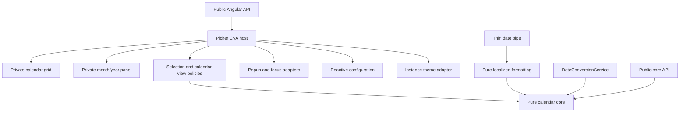

# Target architecture and implementation plan

Preserve `libs/ngx-nepali-dualpicker` and `apps/playground`. The existing calendar offsets, table and conversion functions are retained. No empty future-feature folders or state framework are required.

1. Rename the picker files with `.component` suffixes and update all supported exports, generated documentation and tests.
2. Separate the legacy zero-based `PickerDate` adapter from public one-based calendar fields; add explicit calendar-system typing without changing serialized form values.
3. Extract pure calendar view calculations, restriction compilation and keyboard navigation. Derive month grids and year options from signal-owned display/configuration state.
4. Introduce private standalone calendar-grid and month/year-panel components. Parent owns value/state; children receive typed views and emit selection/navigation intents. Grid owns DOM focus and one roving tab stop.
5. Extract popup geometry and active-popup browser listeners. Keep the current package dependency footprint; measure actual popup height and capture nested scrolling. CDK adoption is a separate compatibility decision, not an unverified cross-major peer addition.
6. Extract pure localized formatting from the Angular date pipe. Keep existing tokens and pipe defaults; tighten numeric parsing without claiming a new full token grammar.
7. Remove configuration's theme side effects, scope CSS to the library host, and keep per-instance theme resolution. Preserve explicit ThemeService methods for existing consumers.
8. Reconcile runtime configuration with active mode/calendar, restrictions, formatting, year options and selection. External writes must not emit form callbacks. Preserve public methods as adapters where practical, deprecating exposed internals rather than adding new public child APIs.
9. Enforce dependency directions, retain regression tests, build/pack both entry points and verify an isolated packed consumer. Record unexecuted accessibility, hydration and full version-matrix work.

Presentation and browser integration depend on domain functions, never the reverse. Configuration is initialization/default state, not a global DOM mutation mechanism. All extracted modules must have current consumers; future date-time, modal and holiday APIs are outside this refactor.
